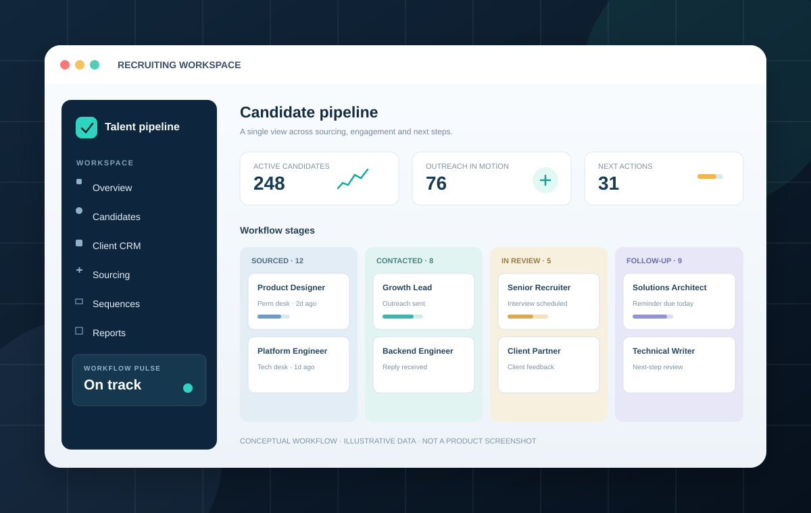

# Recruiterflow APMM Portfolio — Surya Sharma

**Product marketing · B2B SaaS · Competitive intelligence · GTM · AI-assisted marketing**

A portfolio case study converting independent Recruiterflow competitor research into positioning, messaging, sales enablement and validation ideas.

> **Portfolio scope:** Independent public-source research and proposed marketing work, not commissioned by or affiliated with Recruiterflow. Recommendations are hypotheses, not shipped changes or measured experiments.

## Start here

- **[Open the interactive portfolio](index.html)** — responsive website and filterable competitor matrix.
- [Competitive intelligence report (PDF)](report.pdf) — research brief PDF.
- [Sales enablement battlecard (PDF)](battlecard.pdf) — discovery, competitor talk tracks and objection handling.
- [AI-assisted marketing workflow (PDF)](ai-assisted-marketing-workflow.pdf) — case study using IBM- and Jio-informed workstreams.
- [Detailed competitive analysis](docs/case-study.md)
- [AI-assisted marketing workflow and prompts](docs/ai-assisted-marketing-workflow.md)
- [Messaging examples](docs/messaging-examples.md)
- [Experiment plan](docs/experiment-plan.md)
- [Feature-explainer script](docs/feature-explainer-script.md)
- [Sales battlecard (Markdown)](docs/sales-enablement-battlecard.md)
- [Sources and method](docs/sources-and-method.md)
- [CV integration copy](docs/cv-integration-copy.md)

## What this demonstrates

1. **Competitive intelligence:** compare Recruiterflow with Bullhorn, Loxo, Crelate and Recruit CRM across positioning, pricing, packaging and workflow claims.
2. **Messaging and content:** identify packaging, segment-fit and comparison-page freshness issues; develop copy directions and an explainer narrative.
3. **Sales enablement:** discovery prompts, objection handling and claim-hygiene guidance.
4. **Measurement mindset:** proposed experiments with baseline, primary metrics and guardrails.
5. **AI-assisted marketing:** reusable prompt patterns for source-grounded competitor synthesis, launch-email variants, landing-page messaging and lifecycle-campaign hypotheses.

## AI workflow: honest framing

The workflow case study uses workstreams from Surya's CV as **context for a retrospective workflow demonstration**: IBM competitor intelligence across 15+ integration platforms, IWHI Global Availability launch emails, a healthcare landing page and the MUDUM customer story; plus Jio Finance cohort-level campaigns and funnel measurement.

It does **not** claim AI was used in the original IBM or Jio roles. Jio CTR and visit metrics are historical CV-reported outcomes, not AI-attributed results. Example prompts and outputs are illustrative portfolio work. Sensitive customer, employee and partner data should never be entered into unapproved AI tools.

## Three findings

- **Packaging clarity:** make the Platform/AIRA boundary understandable for buyers.
- **Segment fit:** lead with the concrete needs of lean agencies where evidence supports that segment.
- **Comparison-page freshness:** assign ownership and a verification cadence to competitor claims.

## Research and claim hygiene

Source notes record public product, pricing, comparison and review pages consulted for a snapshot dated 26 October 2026. Pricing, ratings, feature availability and vendor claims change; re-check them before external use. Third-party reported pricing is labelled as directional where appropriate.

The case study uses desk research only. No private interviews, win/loss analysis or actual A/B experiments were conducted. Proposed copy is not approved Recruiterflow collateral.

## Publish the site

A GitHub Actions workflow is included in `.github/workflows/pages.yml`. After committing to `main`, set **Settings → Pages → Build and deployment → GitHub Actions** if needed. Confirm deployment succeeded before using the live URL.

*Concept illustration only; not a screenshot of Recruiterflow's product.*

---

*Prepared by Surya Sharma · Associate Product Marketing Manager work sample · October 2026*