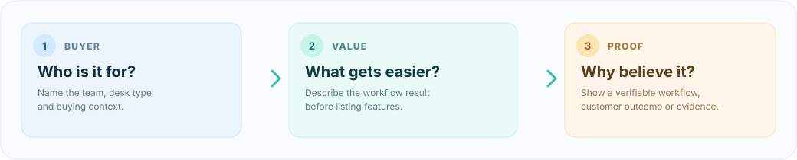
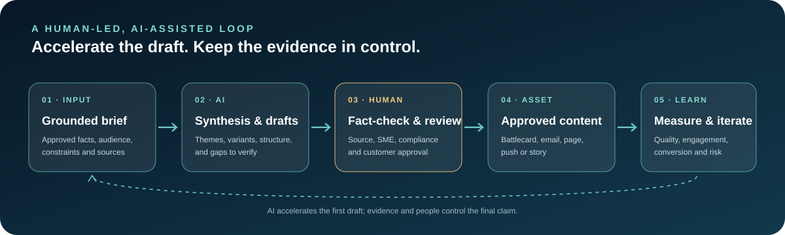

# Recruiterflow APMM Portfolio — Surya Sharma

**Product marketing · B2B SaaS · Competitive intelligence · GTM · AI-assisted marketing**

A portfolio case study that converts independent research on Recruiterflow and its competitive set into actionable positioning, messaging, sales enablement and validation ideas.

> **Portfolio scope:** Independent desk research and proposed marketing work, not commissioned by or affiliated with Recruiterflow. Recommendations are hypotheses, not shipped changes or measured experiments.

## Start here

- **[Open the interactive portfolio](index.html)** — responsive site and filterable competitor matrix.
- [Competitive intelligence report (PDF)](report.pdf) — four-page research brief.
- [Sales enablement battlecard (PDF)](battlecard.pdf) — discovery, competitor talk tracks and objection handling.
- [AI-assisted marketing workflow (PDF)](ai-assisted-marketing-workflow.pdf) — portfolio workflow case study linking IBM and Jio Finance workstreams.
- [Detailed competitive analysis](docs/case-study.md)
- [AI-assisted marketing workflow and prompt examples](docs/ai-assisted-marketing-workflow.md)
- [Messaging examples](docs/messaging-examples.md)
- [Experiment plan](docs/experiment-plan.md)
- [Feature-explainer script](docs/feature-explainer-script.md)
- [Sales enablement battlecard (Markdown)](docs/sales-enablement-battlecard.md)
- [Sources and research method](docs/sources-and-method.md)
- [CV integration copy](docs/cv-integration-copy.md)

## What this demonstrates

1. **Competitive intelligence:** compare Recruiterflow with Bullhorn, Loxo, Crelate and Recruit CRM across positioning, pricing, packaging and workflow claims.
2. **Messaging and content:** identify gaps in packaging clarity, segment fit and competitor-page freshness; develop copy directions and an explainer narrative.
3. **Sales enablement:** offer discovery prompts, objection handling and claim-hygiene guidance for sales conversations.
4. **Measurement mindset:** define hypotheses, test plans and guardrails rather than presenting recommendations as proven outcomes.
5. **AI-assisted marketing:** demonstrate structured prompting for source-grounded competitor synthesis, launch-email variants, landing-page messaging and lifecycle-campaign hypotheses.

## AI workflow: honest framing

The workflow case study uses workstreams from Surya's CV as **context for a proposed retrospective workflow demonstration**: IBM competitor intelligence across 15+ integration platforms, IWHI Global Availability launch emails, a healthcare landing page and the MUDUM customer story; plus Jio Finance cohort-level campaign work and funnel measurement.

It does **not** claim AI was used in the original IBM or Jio roles. The Jio CTR and visit metrics cited in the CV are historical outcomes and are not attributed to AI. Example prompts and outputs are illustrative portfolio work. Sensitive customer, employee and partner data should never be pasted into unapproved AI tools.

## Preview images

*Concept illustration only; it is not a screenshot of Recruiterflow's product.*

## Research and claim hygiene

Source notes record the public pages and review sites consulted for the snapshot dated 26 October 2026. Pricing, ratings, feature availability and vendor claims can change, so re-check them before external use. Third-party reported pricing is labelled as directional where appropriate.

## Publish the site

The repository includes a GitHub Actions workflow at `.github/workflows/pages.yml`. After pushing to `main`, set **Settings → Pages → Build and deployment → GitHub Actions** if necessary. When the deployment succeeds, confirm the generated Pages URL and test the site and PDFs in a signed-out browser.

---

*Prepared by Surya Sharma · Associate Product Marketing Manager work sample · October 2026*
